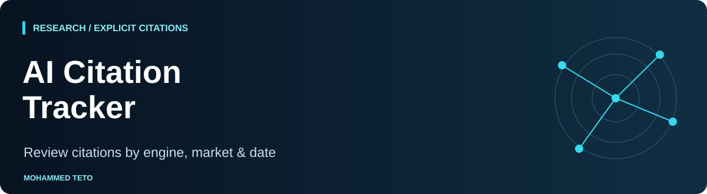

# AI Citation Tracker

[](https://github.com/mhdteto/ai-citation-tracker/actions/workflows/ci.yml)


Turn supplied AI answer observations into reproducible reports of **explicit citations**. A dependency-free, offline Python CLI for researchers and communications teams who need to inspect what was actually cited, including answers with no citations.

[Research](https://mohammedteto.com/research/) · [Method](https://mohammedteto.com/method/) · [Input and methodology](docs/METHOD.md) · [Example report](examples/report/report.html)

<!-- shared-nav -->
<p>
  <a href="https://mohammedteto.com"></a>
  <a href="https://mohammedteto.com/method/"></a>
  <a href="https://mohammedteto.com/research/"></a>
</p>

<!-- suite-navigation -->
## Start here: this repository in the workflow

**Your task:** Analyze explicit citations in supplied answers.

[Method →](https://github.com/mhdteto/authority-architecture-system) · [Audit →](https://github.com/mhdteto/search-ai-discoverability-checker) · [Structure →](https://github.com/mhdteto/entity-structured-data-kit) · [Measure →](https://github.com/mhdteto/ai-citation-tracker)

**Next step:** [authority-architecture-system](https://github.com/mhdteto/authority-architecture-system) — Use the measurement protocol before comparing observation windows.

**Try it:** [complete fictional workflow](https://github.com/mhdteto/authority-architecture-system/tree/main/examples/fictional-workflow) · [this tool’s inputs, command and expected output](examples/connected-workflow/README.md). All scenario records and engine answers are invented; generated reports are real CLI output.

**Python CI:** 3.10 / 3.13. The badge links to the real workflow; it describes automated checks, not ranking, factual accuracy or AI visibility.
[Map of all eight resources](https://github.com/mhdteto/authority-architecture-system/blob/main/docs/tool-map.md) · [Open an issue](https://github.com/mhdteto/ai-citation-tracker/issues/new/choose)
<!-- /suite-navigation -->

## What you get

- Separate engine, model, interface, language and market groups.
- Distinct normalized citation URLs and hostname counts per answer.
- Group answer counts, cited-answer fractions and citation averages with explicit denominators.
- JSON, four CSV tables and a standalone navy/cyan HTML report with expandable raw observations.
- Strict CSV/date/reference validation and protections against input overwrites, HTML injection and spreadsheet formulas.

No accounts, API keys, dependencies, network requests or telemetry. This is an observation tool: it does not query AI engines, crawl websites, infer uncited use, judge claim support or calculate a universal authority score.

## Run the fictional example

Python **3.10+** is the declared support range. The implementation also runs on the development machine's Python 3.9.6; CI checks 3.10 and 3.13.

```sh
python3 tracker.py --answers examples/answers.csv --citations examples/citations.csv --as-of 2026-11-01 --output examples/report
python3 -m unittest discover -s tests -v
```

Open `examples/report/report.html` locally in a browser. No server is needed. Running the same command with the same inputs and `--as-of` produces identical files. Existing report files in the chosen directory are overwritten after collision checks; use a new directory to keep a previous run.

The checked-in example is entirely fictional: Northstar Studio, Atlas Lab, the engines and all answer text are synthetic. Reserved `.example` URLs are used without contacting them. The observations span English/French and the UK, Canada, UAE and Morocco to demonstrate group separation, not real performance.

## Bring your observations

Save UTF-8 CSV with these exact ordered headers:

```csv
answer_id,collected_on,engine,model,interface,language,market,prompt_id,prompt,answer_text
```

```csv
answer_id,citation_url
```

One answer per row; one explicit citation URL per row. Retain the full answer text and source capture privately for provenance. Answers without citations require no citation row and remain in every relevant denominator. A citations file containing only its header is valid.

```sh
python3 tracker.py --answers my-answers.csv --citations my-citations.csv --as-of 2026-11-01 --output my-report
```

Supply a deliberate date cutoff; future observations are rejected. `interface` is `web`, `app`, `api` or `other`; engine/model/market are nonempty free-text labels, without a presumed provider registry. Use consistent labels. `language` is a short tag such as `en`, `fr` or `fr-MA`. See [the field contract and limitations](docs/METHOD.md) before collecting data.

## Read the numbers

| Metric | Definition |
| --- | --- |
| Answer count | All imported answers in this exact group, including uncited answers |
| Cited answer count | Answers with at least one accepted explicit URL |
| Explicit citation count | Sum of distinct normalized URLs per answer |
| Cited answer rate | Cited answers / all answers; fraction between 0 and 1 |
| Citations per answer | Explicit citations / all answers |
| Citations per cited answer | Explicit citations / cited answers; blank/null if none |
| Hostname answer count | Answers containing at least one citation to that hostname |

Duplicate citations within one answer collapse. Repeated answers with different IDs count independently. Different query strings stay distinct. `docs.example.org` and `example.org` remain different **hostnames**, not merged registrable domains. No Public Suffix List or network lookup is used.

## Compare windows carefully

Create separate input CSVs and output directories for each date window and open the reports side by side. V1 intentionally has no automated trend/delta command. Match engine/model/interface/language/market, prompt IDs **and exact prompt text**, collection method, repeated-answer counts and window lengths before comparing. The report retains prompt IDs in JSON and full prompt records in raw details. Different prompt sets or sample sizes can change a rate without any engine-level change. Dates are observation metadata, not evidence of historical coverage.

### Fictional windows, side by side

The sample uses fixed windows **2026-10-01–06** and **2026-10-15–20** with identical prompt IDs/text, group labels and repeat counts. These invented counts show report interpretation only, without a real collection process or trend claim. [Window one](examples/report/report.html) · [Window two](examples/window-two-report/report.html).

| Engine / model / interface / language / market | W1 cited / answers | W1 citations | W2 cited / answers | W2 citations |
| --- | --- | --- | --- | --- |
| Fictional Atlas / demo-1 / web / en / UK | 2 / 3 | 3 | 3 / 3 | 4 |
| Fictional Atlas / demo-1 / web / en / Canada | 1 / 1 | 1 | 0 / 1 | 0 |
| Fictional Atlas / demo-1 / web / fr / Morocco | 1 / 2 | 1 | 1 / 2 | 1 |
| Fictional Meridian / demo-2 / api / en / UAE | 1 / 2 | 2 | 1 / 2 | 2 |

```sh
python3 tracker.py --answers examples/window-two-answers.csv --citations examples/window-two-citations.csv --as-of 2026-11-01 --output examples/window-two-report
```

## Related independent tools

[Geo Prompt Audit Dashboard](https://github.com/mhdteto/geo-prompt-audit-dashboard) helps visualize prompt audits. [Authority Evidence Mapper](https://github.com/mhdteto/authority-evidence-mapper) supports evidence and claim review. Neither tool turns a citation count into proof of a claim.

## Contribute and license

See [CONTRIBUTING](CONTRIBUTING.md), [SECURITY](SECURITY.md) and [CHANGELOG](CHANGELOG.md). Code, tests and workflow are [MIT licensed](LICENSE). Documentation, synthetic example data and artwork are [CC BY 4.0](LICENSE-DOCS.md). Reports you generate from your own data remain your data, subject to any applicable source rights. Independent project by Mohammed Teto; no employer or AI provider endorsement is implied.
